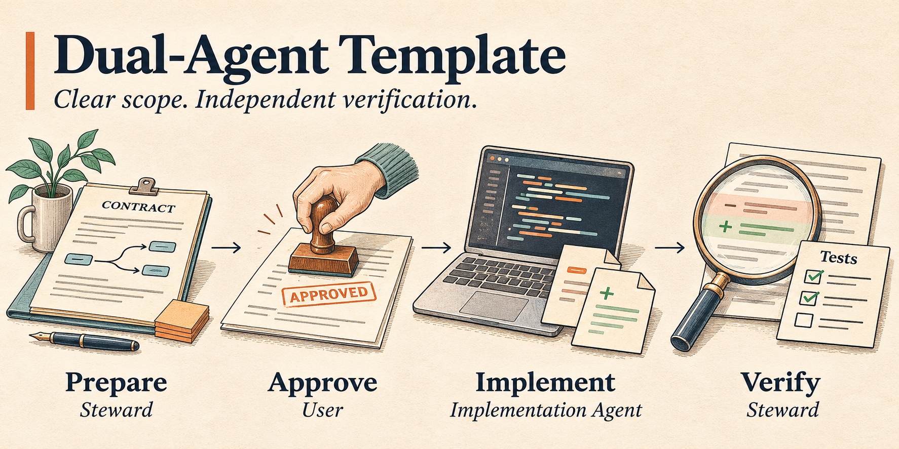

# Dual-Agent Development Template

English | [简体中文](README.zh-CN.md)



**A reusable workflow for developing software with two AI agents, clear permissions, and independent verification.**

AI agents can make changes quickly. Across several rounds, keeping track of what was approved, what actually changed, and what the tests established takes deliberate work. This template gives that work a consistent place in the development process.

The **Task Steward** turns a goal into a reviewable task, defines the allowed changes, and independently checks the delivered result. The **Implementation Agent** works within the approved scope and submits its changes and test results. **You** approve the scope and decide when the work should expand.

Start with two role prompts and one round worksheet. For projects that need more structure, the optional Python tools prepare drafts, freeze inputs, check file identities, record decisions, and help reuse valid acceptance evidence. The workflow runs through your existing agent tools and conversations, with each round ending in a concise summary.

For example, a bug-fix round can authorize changes to one function and its tests, define the expected behavior, and specify the checks to run. After implementation, the Steward reviews the actual diff and independently runs those checks. A remaining defect becomes a concrete finding for review before another correction round.

This project grew out of the multi-round development of ForeContract. It brings together the practices that helped keep scope, evidence and temporary data manageable. Contributions are welcome, especially reports of confusing steps, reproducible tool failures, and examples from other projects.

## Ask your agent to set it up

Give an agent the template location and target project path. It can inspect the project, initialize the selected workflow and prepare the first worksheet. Use two conversations for the Steward and implementer; both can use the same model. The supplied tools generate and check files. You or your existing agent host handles delivery between conversations.

Send this prompt to the Steward, replacing the placeholders:

```text
Act as Task Steward and help me adopt the dual-agent template.

Template directory: <absolute template path>
Target project: <absolute project path>
Project name: <name>
Goal: <feature or fix>
Mode: <manual worksheet / structured Python tools>
Implementation Agent: <name or conversation identity>

Read the template README and TASK_STEWARD_BOOTSTRAP_PROMPT.en.md.
Inspect the target's existing instructions, source, test entry points
and uncommitted changes.
Initialize the selected mode. If existing files conflict, show the
specific differences for my approval before merging.
Complete lightweight P0, exercising the automatic controls required
by the first round with positive and negative cases.
Prepare one first-round worksheet with the goal, allowed files,
acceptance assertions, complete test commands and output locations.
Submit it for my approval before dispatch.
```

After approval and delivery, send the following to the implementer:

```text
Act as Implementation Agent.
Project directory: <absolute project path>
Your assigned identity: <approved agent name>
Round worksheet or dispatch entry: <actual absolute delivery path>

Read IMPLEMENTATION_AGENT_BOOTSTRAP_PROMPT.en.md in
<absolute template path>, the project's instructions and this round's contract.
Verify task, round, P0, approval, assigned identity, actual dispatch
and input versions.
Implement the approved paths and operations, run the agreed checks,
and return actual changes, test results and unexecuted checks
for independent Steward verification.
Report missing authorization or conflicting scope before proceeding.
```

Return to the Steward conversation for acceptance against the round contract. After acceptance, close the round's permissions and keep a concise summary. If corrections are needed, review and approve the next scope before implementation.

## Clone once, reuse across projects

Keep the template checkout alongside your business projects. For example, initialize two structured projects on Windows:

```powershell
git clone https://github.com/zale-pan/dual-agent-template.git "D:/Projects/dual-agent-template"
python -B "D:/Projects/dual-agent-template/init_project.py" "D:/Projects/MyApp" --name "MyApp"
python -B "D:/Projects/dual-agent-template/init_project.py" "D:/Projects/MyService" --name "MyService"
```

On macOS or Linux:

```sh
git clone https://github.com/zale-pan/dual-agent-template.git "$HOME/Projects/dual-agent-template"
python3 -B "$HOME/Projects/dual-agent-template/init_project.py" "$HOME/Projects/MyApp" --name "MyApp"
```

Each target receives its own AGENTS.md and .dual-agent/ and maintains its own tasks, approvals, acceptance records and summaries. Initialization copies the tools and templates; projects execute their local copies. Complete P0 separately for every new project. Reuse template content while binding authorization and evidence to the actual project. Business code can use any language; Python runs the optional template tools.

For an existing business repository, use its root as the target. First review its AGENTS.md, uncommitted changes and active rounds. Conflicting file contents stop initialization so the Steward can prepare a merge for review. Keep template and target directories separate; sibling directories work. For manual use, copy the English worksheet and role prompts linked below. The initializer's --manual option copies the Chinese equivalents.

To update later, run `git pull --ff-only` in the template checkout. Preview and apply upgrades separately for each target project, using that project's own preview digest. Follow “Upgrading a structured project” below. Preserve project-specific configuration, approvals and round records, and review local tool edits before replacement.

## Getting started

For small changes, use the [round worksheet](templates/docs/lifecycle/round-worksheet.en.md) and give each agent its role prompt: [Task Steward](TASK_STEWARD_BOOTSTRAP_PROMPT.en.md) and [Implementation Agent](IMPLEMENTATION_AGENT_BOOTSTRAP_PROMPT.en.md). Fill in the goal, allowed files, acceptance commands and approval. Expand the startup section for the first round and the evidence section when needed.

Every new project starts with a lightweight P0 review. Record the project root, goal, responsible people or agents, protected files and independent acceptance entry point. Exercise every automated control needed by the first round with a valid input and a rejecting input in the actual environment. If a required control needs adaptation, approve a separate adaptation task. Dispatch business work once the startup decision is ready.

Manual users can copy the three linked English documents directly. The initializer's manual mode currently copies the Chinese documents. Run one of these commands from the template root:

```powershell
python -B init_project.py "D:/Projects/MyScript" --name "MyScript" --manual
python -B init_project.py "D:/Projects/MyProject" --name "MyProject"
```

The Python tools require Python 3.10+ and use the standard library. Structured initialization creates AGENTS.md and .dual-agent/ in the target, fills in the project name, generates three review views, and includes the English implementation prompt required by packaging. The project starts in draft with P0 pending. Complete its project identity and controls before dispatch.

Initialization checks conflicts before writing. Existing identical files are accepted; different content at the same path stops initialization for manual resolution. Keep the target free of concurrent writes. For existing projects, complete active rounds using their frozen layout. The initializer does not migrate historical packages.

From a structured project's root, check its generated views with:

```powershell
python -B .dual-agent/tools.py review_views --check
```

Governance tests are optional. Add --with-governance-tests during structured initialization if the target needs them. This option is mutually exclusive with --manual. With pytest installed, run those tests from .dual-agent using `python -B -m pytest -p no:cacheprovider tests/governance`. Run business tests from the business project root.

Repository checks verify inputs and changes. Enforcement before a write depends on the agent host's restricted tools or OS permissions. Verify both an allowed write and a rejected out-of-scope write under the actual implementation identity, including unchanged file contents after rejection, when that protection is required.

## Preparing a round

From the initialized project root:

```powershell
python -B .dual-agent/tools.py new-round APP-42 round-001
```

This creates .dual-agent/task_interactions/APP-42/round-001/轮次工作单.md with task, round, path and draft fields. Generated worksheet text currently uses Chinese. English manual users can use the English worksheet linked above.

Add --structured on the first creation to also generate instruction.draft.md and acceptance-plan.draft.json. Commands and authorized paths start empty. An existing round directory causes a nonzero exit while preserving its contents. Continue editing the existing draft.

The Steward fills in the goal, exact scope and acceptance criteria for review. Creating a draft leaves authorization and P0 unchanged. Approval, frozen inputs and actual delivery are separate decisions recorded before implementation.

For promotion, field synchronization, freezing and execution, follow the [structured round guide (Chinese)](templates/docs/STRUCTURED_ROUND.zh-CN.md).

## Dispatch, verification and closure

1. Confirm the P0 decision and agree on one substantive round contract.
2. Record user approval, freeze the required inputs, deliver them to the named implementer, and read back the actual delivered files. Dispatch checks identity and delivery.
3. The implementer makes the authorized changes and reports actual results.
4. The Steward reviews the diff and independently runs the affected checks. Reuse earlier results only when their inputs, dependencies, commands and environment remain valid. Record failures and checks that were not run.
5. Close implementation permission and retain one concise round summary. Materials with active consumers remain until references are released. List exact cleanup targets and obtain authorization before deletion.

In a structured shared workspace, dispatch-round binds approval to delivery, submit-round registers the implementation submission, and close-round closes permissions using the independent acceptance decision. See the structured guide for their complete record formats.

## Optional event ledger

Projects explicitly enabling the ledger can use `python -B .dual-agent/tools.py append-event` to record decisions already made. Its evidence requirements, retries and concurrency behavior are described in the [event protocol](templates/EVENT_LOG_PROTOCOL.md). Projects with the default unused ledger continue with the worksheet and short summary.

External calls, spending, publication, additional writes and cleanup require explicit authorization. A tool records decisions made by the responsible people or agents.

## Testing the template

Install pytest 8+ in your Python environment. From the template root, run the following in PowerShell:

```powershell
$env:PYTHONPATH = (Resolve-Path templates).Path
python -X utf8 -B -m pytest -p no:cacheprovider -q tests templates/tests -rs
```

On Linux:

```sh
PYTHONPATH=templates python3 -X utf8 -B -m pytest -p no:cacheprovider -q tests templates/tests -rs
```

Some checks use platform-specific filesystem capabilities. Read the reported skip reasons when interpreting results.

## Planning a project

Before implementation, describe the users, purpose, deliverables, exclusions and protected areas. Turn goals into observable acceptance criteria, define component responsibilities and interfaces, then identify phases, dependencies and exit conditions. Link goals and acceptance criteria to tasks and review the first task for readiness.

Small projects can keep this information in the worksheet. Larger projects can use the structured planning files and generated review views. The optional Python modules include governance.round_package, governance.review_views and governance.steward_workflow. The workflow runner requires the structured task, authorization and event inputs it validates. schema_version identifies a data format.

Further material currently includes Chinese [startup guidance](templates/docs/PROJECT_STARTUP.zh-CN.md), [orchestration rules](templates/docs/STEWARD_ORCHESTRATION_RULES.zh-CN.md), [acceptance rules](templates/docs/ACCEPTANCE_EXECUTION_RULES.zh-CN.md), [storage rules](templates/docs/lifecycle/存储与清理.md), and [design notes](DESIGN_NOTES.zh-CN.md). The [planning examples](examples/README.md) also include some English task and roadmap documents.

## Upgrading a structured project

Run from the template root using the original project name. If the project was initialized with --with-governance-tests, include that option in both commands.

```powershell
python -B init_project.py "D:/Projects/MyProject" --name "MyProject" --upgrade-preview
```

Review the JSON lists of missing files, tools to replace and project documents requiring manual comparison. Confirm that local tool edits may be replaced, then use the returned plan_sha256:

```powershell
python -B init_project.py "D:/Projects/MyProject" --name "MyProject" --upgrade --plan-sha256 "<plan_sha256 from this preview>"
```

If the plan changes, preview and review again. Keep the target free of concurrent writes throughout the upgrade. Manual-mode documents are compared and merged individually by the project maintainer.

## License

Developed from the dual-agent workflow used in ForeContract. Copyright 2026 Zale Pan. Licensed under [Apache License 2.0](LICENSE).


## Platform support and macOS CI

Windows and Ubuntu have been tested locally. macOS is included in the GitHub Actions matrix with Python 3.10, 3.11 and 3.13; the first remote run passed all three macOS combinations. Every matrix job runs the complete root and governance suites and reports skip reasons. Failures fail the job. The workflow can also be started manually after upload.

Manual worksheets and prompts can be used on macOS. The Python workflow runner now selects a macOS kqueue vnode witness for directories and regular files. Read-session caching observes those notifications, and final inventory reads are independent of the admission cache. A registration or event-read failure prevents acceptance eligibility. Notifications for directories are retained conservatively even if they may concern an excluded child.

Portable API-double tests cover notification handling, cache invalidation with identical signatures, clean and changed inventories, monitoring failures and descriptor cleanup. These tests validate integration logic; native restored-write, directory-change and clean-audit controls passed on the first macOS CI run.

The macOS CI must verify the existing clean-and-restored-write control, the new native vnode test (restored bytes and mtime, transient directory changes), symlink rejection, and subprocess/port cleanup. Large trees may exhaust file descriptors because each watched file and directory holds one descriptor; registration failure rejects eligibility. Establish supported filesystem and project-size limits from real macOS results before claiming broader support. Network filesystem behavior remains unverified.

Three expected platform skips on macOS are Windows open-handle deletion semantics, Windows command syntax, and the Linux notification queue test. Symlink tests should normally run. Review any additional skips individually. The clean-workspace and restored-write controls have no platform skip.

The first CI run passed all macOS and Ubuntu combinations. Windows exposed a legacy console-encoding failure in new-round. The CLI now emits UTF-8, with CP1252 and ASCII regression cases; the follow-up CI checks this correction.


A subsequent Windows CI run also detected stale cached bytes after a same-size write with restored mtime. Windows reads now revalidate file bytes before reusing cached results. This increases physical reads while retaining JSON parse reuse for unchanged content. A fixed-signature regression covers the failure. On Linux and macOS this Windows-specific regression is an additional expected skip.
