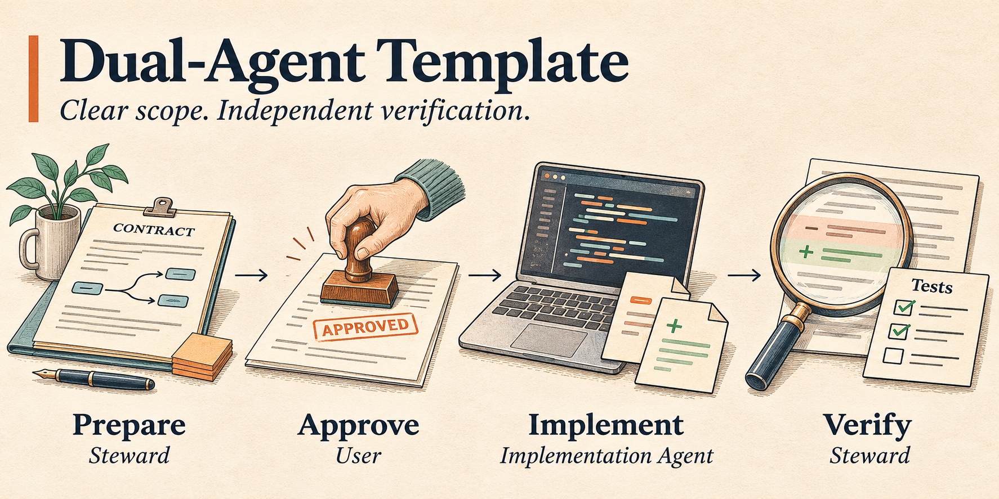

# 双代理开发模板

[English](README.md) | 简体中文



**一套可复用的双代理开发工作流，让 AI 协作中的授权、实施和独立验收有据可查。**

AI Agent 改代码很快。随着修正轮次增多，哪些修改获得了批准、实际改了什么、测试究竟证明了什么，都需要有人持续核对。这份模板为这些工作提供了一套可以直接复用的流程。

**Task Steward** 负责把目标整理成可审阅的任务，明确允许修改的范围，并独立核对交付结果。**Implementation Agent** 按批准范围实施，提交实际改动和测试结果。**你**决定是否批准，以及何时扩大工作范围。

从两份角色提示词和一张轮次工作单开始。项目需要更细的记录时，再启用 Python 工具生成草稿、冻结输入、核对文件身份、登记决定和复用有效验收证据。两个 Agent 通过你现有的工具和对话协作，每轮最终留下一份简短总结。

例如，修复一个计算错误时，可以先授权修改指定函数及其测试，写清正确行为和验收命令。实施完成后，Steward 核对实际差异并独立运行检查。如果仍有缺陷，就把具体失败交给你审阅，再决定下一修正轮。

这份模板来自 ForeContract 多轮开发中的实践，整理了控制修改范围、核对验收证据和管理临时数据的方法。欢迎提交难以理解的流程、可复现的工具问题，以及在其他项目中的使用经验。

## 从哪里开始

**手工使用**适合短脚本、小型改动和有人逐轮审批的原型。给两个 Agent 各一份中文启动提示词，用一份工作单完成轻量 P0、范围批准、独立验收和关权限。首轮无需读取完整 JSON 或存储手册；出现共享引用、真实清理或恢复时，Steward 再查相应章节。下方命令可代为复制这三个文件，也可手工复制。

**使用 Python 工具**适合需要复用冻结包、校验输入身份或执行结构化检查的项目。初始化器把项目骨架放在 .dual-agent/，并生成包工具需要的英文实施提示词。完整初始化会用本项目的实际事实文件生成三份审阅页；业务仓库根目录仅新增 AGENTS.md 和 .dual-agent/。从业务项目根目录运行 `python -B .dual-agent/tools.py review_views --check`。默认不复制治理测试；需要随项目自检时加 --with-governance-tests，与 --manual 互斥。初始化器自身的测试只留在模板库的 tests/。初始化后项目仍处于 draft、P0 pending；填入各自项目身份和控制。需要写入前强制隔离时，应在真实实施身份上配置受限工具或 OS 权限，并实测合法写入成功、越界写入被拒且文件未变。

从本模板根目录选用一行 PowerShell 命令：

```powershell
python -B init_project.py "D:/Projects/MyScript" --name "MyScript" --manual
python -B init_project.py "D:/Projects/MyProject" --name "MyProject"
```

已有项目可指定原目录。请在目录无人并发写入时执行。工具先预检冲突，同名同内容跳过，同名不同内容停止供人工合并。它不安装依赖、不授予写权限、不执行项目命令。手工工作单内填写项目名；结构化初始化自动填写四份事实 JSON 和项目简报中的项目名。

小改动打开工作单先填目标、允许改的文件、验收命令和批准。首次使用再展开 P0；复杂轮次按实际需要展开证据表。旧项目按原冻结布局完成进行中的轮次，新初始化器不会迁移历史文件。目标项目已有不同内容的 AGENTS.md 时，初始化会在写入前停止，原文件保留。选择安装治理自检后，可在 .dual-agent 目录执行 `python -B -m pytest -p no:cacheprovider tests/governance`。业务测试仍在项目根运行。

## 创建待审轮次

在已完成结构化初始化的项目根执行：

```powershell
python -B .dual-agent/tools.py new-round APP-42 round-001
```

默认只创建 `.dual-agent/task_interactions/APP-42/round-001/轮次工作单.md`，填好任务、轮次、工作单路径和草案标记。Steward 填写目标、允许修改的文件及验收方式后交给用户审阅。需要结构化草稿时，在**首次创建**时加 `--structured`，同目录另生成 `instruction.draft.md` 和 `acceptance-plan.draft.json`；后者的命令及授权路径初始为空。

同一轮次路径已存在时，命令返回非零并保留原目录全部内容，包括已填工作单。继续编辑已有工作单即可。创建草稿不会改变 P0、当前任务或实施权限，也不会冻结、下发或创建事件。纯手工使用者继续直接复制工作单。

结构化草稿如何转正、自动同步字段、冻结、下发和执行，见[从草稿到独立验收](templates/docs/STRUCTURED_ROUND.zh-CN.md)。

## 可选事件账本

共享工作区日常使用 dispatch-round 将具体批准与实际下发连起来，submit-round 登记实施者的实际交付。Steward 独立验收后用 `close-round TASK round-001 --record <独立验收决定路径>` 关闭本轮写权限并同步当前路由。用法和新修正轮的批准要求见[结构化轮次说明](templates/docs/STRUCTURED_ROUND.zh-CN.md)。

项目明确启用账本时，Steward 可用 `python -B .dual-agent/tools.py append-event` 登记已经作出的决定。参数、证据字段、重试与并发恢复见[事件协议](templates/EVENT_LOG_PROTOCOL.md)。默认 unused 的项目继续使用工作单与短总结。

## 使用步骤

1. 按[首次启用清单](ACTIVATION_CHECKLIST.zh-CN.md)完成每个新项目必做的[轻量 P0](templates/docs/PROJECT_STARTUP.zh-CN.md)，再按项目启动结论决定能否下发首个业务任务。给 Steward [启动提示词](TASK_STEWARD_BOOTSTRAP_PROMPT.zh-CN.md)，给实施者[中文](IMPLEMENTATION_AGENT_BOOTSTRAP_PROMPT.zh-CN.md)或[英文提示词](IMPLEMENTATION_AGENT_BOOTSTRAP_PROMPT.en.md)。
2. 用[轮次工作单](templates/docs/lifecycle/轮次工作单.md)准备、批准和下发。已有项目先核对当前冻结合同。
3. 执行[Steward 编排规则](templates/docs/STEWARD_ORCHESTRATION_RULES.zh-CN.md)与[独立验收规则](templates/docs/ACCEPTANCE_EXECUTION_RULES.zh-CN.md)。关闭权限后按[存储规则](templates/docs/lifecycle/存储与清理.md)退役过程材料，每轮保留一份简短总结。
4. 项目可按需使用结构化包、派生审阅页和命令运行器。运行器依赖真实的结构化任务、授权和事件输入；只有项目已经具备这些输入并明确采用时才调用。Python 导入入口为 governance.round_package、governance.review_views 和 governance.steward_workflow。schema_version 记录数据格式。
5. [任务拆解示例](examples/README.md)与[设计依据](DESIGN_NOTES.zh-CN.md)供规划时查阅。

## 在独立模板目录验证
在装有 pytest 的 Python 环境，从模板根目录执行 PowerShell 命令。

```powershell
$env:PYTHONPATH = (Resolve-Path templates).Path
python -X utf8 -B -m pytest -p no:cacheprovider -q tests templates/tests -rs
```

## 1. 完整流程不是从双代理开始

双代理是“执行与验收层”，前面必须先完成项目定义和任务拆解。可复用的完整流程
应为：

```text
项目输入与现状盘点
  -> 使命、用户、交付物、非目标、受保护面
  -> 目标与可验证验收条件
  -> 架构边界和组件责任
  -> 阶段、依赖和退出门禁
  -> 全量任务清单
  -> Goal / AC / Phase / Task 追踪核对
  -> 第一项任务就绪审查
  -> 双代理实施、独立验收和状态推进
```

如果没有前六步，`CURRENT_TASK.md` 只是一个提示词入口，不是可靠的项目计划。
本模板把规划层和双代理执行层都纳入范围。

## 规划与交付
项目简报写清使用者、目标与边界；架构说明列出组件职责、接口和受保护对象。按可独立观察的结果拆任务，说明实现路径、正反例、命令、验收者和依赖。复杂项目可生成路线图与审阅页，简单项目将这些内容合入工作单。下发时冻结一份实质合同；已有用户批准只绑定该次范围。具体操作见上方工作单与两份角色提示词。

## 升级已有结构化项目

在模板根目录运行以下 PowerShell 命令。项目名沿用初始化时的值。如果安装时选择了 `--with-governance-tests`，请在预览和应用两条命令中都加上该参数。

```powershell
python -B init_project.py "D:/Projects/MyProject" --name "MyProject" --upgrade-preview
```

检查 JSON 中将创建的文件、将替换的工具，以及需要人工比对的项目文件。确认工具中的本地修改可以替换后，把本次返回的 `plan_sha256` 填入下一条命令。

```powershell
python -B init_project.py "D:/Projects/MyProject" --name "MyProject" --upgrade --plan-sha256 "<本次预览的 plan_sha256>"
```

如果计划发生变化，重新预览并核对。升级期间请保持目标目录无人并发写入。手工模式的三个 Markdown 文件由项目维护者逐份比较和合并。

## 英文入口与许可

英文使用者可直接复制[英文 Steward 提示词](TASK_STEWARD_BOOTSTRAP_PROMPT.en.md)、[英文实施提示词](IMPLEMENTATION_AGENT_BOOTSTRAP_PROMPT.en.md)和[英文轮次工作单](templates/docs/lifecycle/round-worksheet.en.md)。初始化器手工模式和 new-round 目前生成中文工作单；结构化流程的详细维护文档目前主要为中文。

Python 工具要求 Python 3.10+，运行使用标准库；模板自检要求 pytest 8+。本模板源自 ForeContract 的双代理开发实践。Copyright 2026 Zale Pan，采用 [Apache License 2.0](LICENSE)。


## 平台支持与 macOS CI

Windows 和 Ubuntu 已在本地实测。GitHub Actions 已加入 macOS，与其他平台一样覆盖 Python 3.10、3.11、3.13；首次远程运行的三个 macOS 组合均已通过。每个组合运行完整根目录和治理测试，输出跳过原因，测试失败会使任务失败。上传后也可手动启动工作流。

macOS 可使用手工工作单和提示词。Python 验收运行器已补齐 macOS kqueue vnode 分支，监控目录和普通文件；读取缓存按事件失效，最终盘点独立读取文件。注册或读取事件失败时拒绝验收通过。目录事件可能来自被排除的子目录，此时保守记录该变化。

跨平台模拟测试覆盖事件处理、相同签名下缓存失效、干净与发生变化的盘点、监控失败和句柄释放。模拟测试验证分支衔接，原生写后恢复、目录变化和干净验收控制已在首次 macOS CI 中通过。

macOS CI 需核对既有干净运行和写后恢复控制、新增原生 vnode 测试（恢复原字节及 mtime、临时目录创建后删除）、符号链接拒绝、子进程与端口释放。每个被监控文件和目录占用一个描述符，大项目可能耗尽描述符；注册失败会拒绝通过。需根据真实 macOS 结果确定支持的文件系统及规模边界，网络文件系统行为尚未验证。

macOS 预期跳过三项平台专用测试，分别是 Windows 打开句柄时的删除语义、Windows 命令语法和 Linux 通知队列。符号链接测试通常应执行，其他额外跳过逐项核对。“干净运行及写后恢复”控制没有平台跳过。

首次 CI 的 macOS 和 Ubuntu 组合全部通过。Windows 暴露了 new-round 在旧控制台编码下输出中文路径失败的问题。CLI 已统一输出 UTF-8，并增加 CP1252 和 ASCII 回归用例，后续 CI 复核该修正。


后续 Windows CI 还发现同长度写入并恢复 mtime 后错误复用旧字节的问题。Windows 现改为复用前重新读取文件字节，会增加实际读取次数，内容不变时仍复用 JSON 解析结果。新增固定签名回归覆盖该失败，Linux 和 macOS 会额外跳过此 Windows 专用控制。
